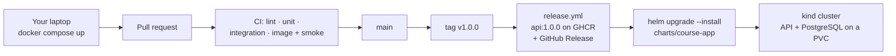

# Capstone · Ship it, run it, explain it

**One fork where everything works together: Compose runs the app on your laptop, the pipeline tests it and ships a release, and Helm runs that release on a Kubernetes cluster. There is nothing new to start. You have been building this fork since Session 1. This brief says what must be true in your fork on 28 November, and how it is graded.**

DevOps (ELE1013M) · Turiba University · individual work · version 2, 9 Nov 2026. It replaces the capstone in the S1 course overview.

| | |
|-|-|
| **You build** | Your fork of `turiba-devops-labs`, with the missions working together, plus `capstone/README.md` |
| **You hand in** | The URL of your fork on Evaluentis: `https://github.com/<you>/turiba-devops-labs` |
| **Deadline** | **Sat 28 Nov 2026, 23:59** (Riga). A snapshot of your fork is taken at 00:04 on Sun 29 Nov. The snapshot is what is graded |
| **Weight** | 30% of the course grade. You need at least **60 of 100** points to pass |
| **Levels** | **Minimum:** up to 70 points (about grade 6–7) · **Target:** up to 90 (about 8–9) · **Excellent:** up to 100 (10) |
| **Exam** | **Mon 30 Nov, 18:15.** It is about this same fork (section 8) |

---

## 1 · What changed from the first version

The course overview in Session 1 described a bigger capstone. This version is built from the missions you actually do.

- **The course app only.** Using your own app is no longer an option. Everyone builds on the same fork, so the same checks work for everyone.
- **No assigned reviewer.** You work alone, and nothing depends on another student.
- **Argo CD, SBOMs, image signing and SLOs** are now Excellent-level extensions. You pick one of them.
- **New dates:** the capstone is due Sat 28 Nov, and the exam is Mon 30 Nov.

## 2 · The road to 28 November

| When | What happens | What it adds to your capstone |
|------|--------------|-------------------------------|
| Done | Labs 1–6 | Dockerfile, Compose, protected `main`, CI with a smoke test, a release from a tag |
| Tue 10 Nov | Mission 7 due | Kubernetes manifests |
| Wed 11 Nov | S8, Mission 8 (due Sat 14 Nov) | PostgreSQL with storage, ConfigMap and Secret, probes |
| Mon 16 Nov | Test 2, then Mission 9 (due Tue 17 Nov) | The Helm chart |
| Wed 18 Nov | Self-study: Mission 10 (due Sun 22 Nov) | OpenTofu *(Target)* |
| Mon 23 Nov | Test 3, then Mission 11 (due Tue 24 Nov) | A Grafana dashboard *(Target)* |
| Wed 25 Nov | **Capstone workshop:** questions, a check that your fork fits together, work time | — |
| **Sat 28 Nov, 23:59** | **Capstone due** | — |
| **Mon 30 Nov, 18:15** | **Exam** | — |

- **A mission that works is a capstone part that works.** If one of your missions is broken, fix it before you start the next one.
- If Mission 11 becomes self-study, use the links in section 9 for the dashboard.

---

## 3 · Minimum: up to 70 points (about grade 6–7)

All of this must be on `main` in your fork, with all four required checks green on the last commit.

| # | What must be true | Built in |
|---|-------------------|----------|
| **M1** | **Containers and local dev.** `api/Dockerfile` is multi-stage and runs as a non-root user. On a fresh clone, `cp .env.example .env` then `docker compose up -d` starts `db`, `api` and `web`, and the todo app works in the browser | Labs 2, 4 |
| **M2** | **Version control.** `main` is protected by your ruleset. Every change came in through a pull request in your fork. Commit messages follow Conventional Commits (`feat:`, `fix:`, `ci:`, `docs:` …) | Labs 3, 5 |
| **M3** | **CI.** On every PR and on `main`, `lint`, `unit`, `integration` and `image` run, with the smoke test in `image`. All four are required checks | Labs 5, 6 |
| **M4** | **Release 1.0.0.** Tag `v1.0.0` on your final `main`. Your `release.yml` pushes `ghcr.io/<you>/turiba-devops-labs/api:1.0.0` (public, `amd64` and `arm64`) and creates the GitHub Release `v1.0.0` with generated notes. Fixed something after the tag? Ship `v1.0.1`. The grader uses your highest `v1.x.y` | Lab 6 |
| **M5** | **Kubernetes with Helm.** `charts/course-app/` installs the API and PostgreSQL on a fresh kind cluster with: • your newest release image (`api:1.0.0`, or the `1.0.x` you shipped after it), never `latest` • readiness and liveness probes, and resource requests and limits • settings in a ConfigMap, and the DB password in a Secret that is **not** in Git • PostgreSQL data on a PVC that survives deleting the database Pod `helm upgrade` and `helm rollback` both work | Missions 7–9 |
| **M6** | **No secrets in Git**, on any branch or tag, in the whole history | Labs 5–8 |
| **M7** | **`capstone/README.md`** with the headings from section 6. Someone who has never seen your repository can follow your "Run it from zero" steps | — |

- **On Kubernetes, you run the API and PostgreSQL.** The `web` front end runs in Compose; running it on the cluster is optional.

## 4 · Target: up to 90 points (about grade 8–9)

Everything in Minimum, plus:

| # | What must be true | Built in |
|---|-------------------|----------|
| **T1** | **Infrastructure as code.** `infra/` holds OpenTofu code. `tofu apply` creates the kind cluster and installs your chart. `tofu destroy` followed by `tofu apply` rebuilds everything. State files are never committed | Mission 10 |
| **T2** | **Security gates in CI:** • a job named `gitleaks` scans the repository on every PR and on `main`, and it is a required check • a Trivy scan of your image runs in the `image` job, before the push. It fails the job on CRITICAL vulnerabilities that have a fix • `.github/dependabot.yml` covers `npm` (directory `/api`), `github-actions` and `docker`, and at least one Dependabot PR has been handled: merged, or closed with a comment that says why • **every third-party action is pinned to a full commit SHA**, with the version in a comment (`uses: owner/action@<40-character SHA> # v1.2.3`) | Self-study, section 9 |
| **T3** | **Observability.** kube-prometheus-stack is installed with Helm (in "Run it from zero" or in `infra/`). A Grafana dashboard shows your app's Pods: ready Pods, restarts, CPU and memory. It's exported to `observability/dashboard.json`. `capstone/README.md` has a screenshot of it, plus 2–3 sentences that read *your own* numbers | Mission 11 |

- **Why pin by SHA?** In March 2026, attackers took over the Trivy GitHub Action and moved 76 of its 77 version tags to malicious code. Every workflow that used `@v0.x` ran the attacker's code and could leak its secrets. A version tag can be moved, but a commit SHA can't ([Aqua's write-up](https://www.aquasec.com/blog/trivy-supply-chain-attack-what-you-need-to-know)).
- **Keep the four required check names** `lint`, `unit`, `integration` and `image`. Add new work as new jobs or new steps (Lab 5, Stretch).

## 5 · Excellent: up to 100 points (grade 10)

Everything in Target, plus **one** extension. In `capstone/README.md`, under `## Extension`, explain why you chose it, what it changes, and how to see it working, and add your evidence. It's worth up to **10 points**: up to 6 for working and being shown, and up to 4 for explaining the choice and its trade-offs.

| Extension | Done when | Start here |
|-----------|-----------|------------|
| **GitOps with Argo CD** | Argo CD in your cluster syncs `charts/course-app` from your fork. A merged PR changes the cluster without you running `helm` | [Argo CD: Getting Started](https://argo-cd.readthedocs.io/en/stable/getting_started/) |
| **SBOM and a signed image** | `release.yml` attaches an SBOM to `api:1.0.0` and signs the image keylessly with cosign. The README shows `cosign verify` passing | [Docker: SBOM attestations](https://docs.docker.com/build/metadata/attestations/sbom/) · [Sigstore CI quickstart](https://docs.sigstore.dev/quickstart/quickstart-ci/) |
| **An SLO with an alert** | One SLO for your API (for example, the share of minutes in which `GET /` answers), its error budget, and a Prometheus alert that you have seen fire | [SRE Workbook: Implementing SLOs](https://sre.google/workbook/implementing-slos/) |
| **A failure drill and a postmortem** | You break something in your running system on purpose (for example, stop PostgreSQL, or roll out a broken image), record when you noticed and when it recovered, and write a blameless postmortem | [SRE Book: Postmortem culture](https://sre.google/sre-book/postmortem-culture/) and its example postmortem |
| **A public cloud** | The same chart runs on a managed cluster in your own free-tier account. No credentials in Git, and torn down afterwards. **Only if you already have an account:** the course never asks you for a payment card | Your provider's docs |

---

## 6 · `capstone/README.md`

Put your write-up in **`capstone/README.md`**, not in the root `README.md`. The course updates the root README, so your changes there would conflict. Use these headings in this order, because the grader looks for them:

| Heading | What goes in it |
|---------|-----------------|
| `## Run it from zero` | The exact commands from a fresh clone to a working app: first Compose, then the cluster and the chart. Include the command that creates the Secret, with a placeholder instead of a real password. **Test it on a fresh clone** |
| `## Architecture` | One diagram (Mermaid is fine) of the parts and how a commit reaches the cluster, plus 3–5 sentences |
| `## What is where` | A table of path → what it is: `api/Dockerfile`, `compose.yaml`, `.github/workflows/…`, `charts/course-app/`, `infra/` … |
| `## Level and evidence` | The level you claim (Minimum, Target or Excellent). For each item: a link to the PR, the workflow run, the release or the file |
| `## When it breaks` | For your app on the cluster: the 3 faults you think are most likely, and for each one, the command that shows it |
| `## Extension` | Excellent only (section 5) |
| `## Known issues` | What doesn't work, and what you tried |
| `## AI use` | In 2–5 lines, what AI tools helped you with (the course rules from S1, "Using AI tools in this course") |

## 7 · Rules

1. **The course app, your own work.** Explaining things to each other and debugging together are fine. Copying someone's files is not.
2. **Every change reaches `main` through a pull request in *your fork*.** Never open a PR in the course repository `mleitass/turiba-devops-labs`.
3. **Your own image from your own pipeline.** The fallback images (`ghcr.io/martinsturiba/…`) were fine for missions. The capstone needs `api:1.0.0` built by *your* `release.yml`.
4. **Catching up with reference files is allowed.** If you use the course's reference or fallback files, say so in `## What is where`. At the exam, you must be able to explain every line of them.
5. **Don't change the course folders** (`lab0N-…/`) or the root `README.md`. **Don't delete** your `labN/` write-ups or your earlier tags, because the earlier mission checks are run again.
6. **If a secret gets into Git, rotate it first** (make a new password or token and stop using the old one). Then remove it from the repository. Once something is pushed to a public repository, treat it as already stolen.
7. **Delete your clusters when you stop for the day** (`kind delete cluster --name …`). Your work is safe in Git.

---

## 8 · How it's graded, and the exam

### Grading

1. **The snapshot** of your fork is taken at 00:04 on Sun 29 Nov. Commit dates are not used.
2. **Scripts check what can be checked:**
   - the required checks on your last commit
   - your release and its image, pulled without logging in
   - a secret scan over the whole history
   - the earlier mission checks
3. **A disposable grading machine runs your chart:** a fresh kind cluster, a Secret created by the grader, then `helm install` from `charts/course-app/`. It checks the Pods, `GET /`, saving a todo, and that the todo survives deleting the database Pod.
   - It only installs object kinds the course uses, such as Deployment, StatefulSet, Service, ConfigMap, Secret, PVC, Namespace and Ingress or HTTPRoute.
   - If it finds anything else (for example, `hostPath` volumes or privileged containers), the lecturer looks at it. That never means an automatic zero.
4. **An LLM drafts feedback against the rubric below. The lecturer reviews every score and decides it.** You get the score and written feedback on Evaluentis.

### Rubric (100 points)

| # | Criterion | Points | Minimum earns | Target adds |
|---|-----------|-------:|---------------|-------------|
| 1 | Containers and local dev | 10 | 10 · M1 | — |
| 2 | Version control and releases | 10 | 10 · M2, the tag and Release in M4 | — |
| 3 | CI pipeline | 15 | 15 · M3, `release.yml` in M4 | — |
| 4 | Delivery on Kubernetes | 15 | 15 · M5 | — |
| 5 | Infrastructure as code | 8 | 2 · everything the app needs is in Git, except the one Secret command | 6 · T1 |
| 6 | Observability and reliability | 10 | 4 · probes that check the app, readable logs, `## When it breaks` | 6 · T3 |
| 7 | Security and supply chain | 12 | 4 · M6, a non-root image, the Secret kept out of Git, workflows that ask only for the permissions they need | 8 · T2 |
| 8 | Documentation | 10 | 10 · M7 | — |
| | **Extension** (Excellent) | 10 | — | — |
| | **Total** | **100** | **70** | **+20**, then **+10** for Excellent |

- **Partial work earns partial points** inside each criterion.
- **A claimed item that doesn't work earns nothing in its criterion, and loses points in criterion 8.** If you list the same gap under `## Known issues`, criterion 8 loses nothing. An honest gap costs less than a hidden one.
- **As a rough guide for the capstone alone:**
  - below 60: not passed;
  - a complete Minimum: about 65–70;
  - a complete Target: about 85–90;
  - Target plus a strong extension: 95 or more.
- The course grade is the weighted sum of all components, on the Turiba 10-point scale.

### The exam, Mon 30 Nov, 18:15–21:30

The exam checks that **you** understand the system you built. It is worth 25% of the course grade.

- **Part 1, 30 minutes, alone:** a bug is put into your project, and you find and fix it. How you get the bug, and which tools you may use, will be announced by the workshop on 25 Nov.
- **Part 2, about 15 minutes each:**
  - walk through your repository;
  - demo a commit reaching the cluster (a small change → PR → green CI → release → `helm upgrade` → see it running);
  - explain your bug fix;
  - answer "what if" questions, such as *"The Pod is in CrashLoopBackOff. What do you check first?"*
- **Prepare at home:**
  - pull the images you need, so your cluster is up in under 5 minutes using your own "Run it from zero";
  - rehearse the demo once from start to finish and time it, including how long your pipeline really takes;
  - bring your laptop charged.

---

## 9 · Learn from (Target and Excellent)

Missions 9–11 come with their own lists. These are for the parts that have no mission: the security gates and the extensions. All links were checked on 9 Nov 2026.

| Resource | What to take from it | Time |
|----------|----------------------|-----:|
| [gitleaks-action](https://github.com/gitleaks/gitleaks-action) | The workflow example. Use `fetch-depth: 0` so that the whole history is scanned. A fork in your personal account needs no licence key | 20 min |
| [trivy-action](https://github.com/aquasecurity/trivy-action) | Scanning an image you just built: the `image-ref`, `exit-code` and `severity` inputs, and the option for vulnerabilities without a fix. **Pin it by SHA** | 30 min |
| [Aqua: the Trivy supply-chain attack](https://www.aquasec.com/blog/trivy-supply-chain-attack-what-you-need-to-know) | What happened in March 2026, and why only a full commit SHA protects you | 10 min |
| [GitHub Docs: secure use of Actions](https://docs.github.com/en/actions/reference/security/secure-use) | "Using third-party actions": how to pin, and how to check that a SHA comes from the real repository and not a fork | 15 min |
| [GitHub Docs: configuring Dependabot version updates](https://docs.github.com/en/code-security/dependabot/dependabot-version-updates/configuring-dependabot-version-updates) | `.github/dependabot.yml`: `version: 2`, then one `updates` entry each for `npm`, `github-actions` and `docker` | 20 min |
| [kube-prometheus-stack chart](https://github.com/prometheus-community/helm-charts/tree/main/charts/kube-prometheus-stack) | Installing Prometheus and Grafana with one `helm install`. For the Grafana login, look at the chart's values (`helm show values`) | 30 min |
| [OpenTofu docs](https://opentofu.org/docs/intro/) | Background for Mission 10, which has the hands-on tutorial | — |

## 10 · Before you submit

| ☐ | Check |
|---|-------|
| ☐ | Clone your fork into a **new folder**, delete your kind clusters, then follow your own `## Run it from zero` word for word. It works |
| ☐ | The last commit on `main` has `lint`, `unit`, `integration` and `image` green (and `gitleaks` too, for Target) |
| ☐ | Release `v1.0.0` (or `v1.0.x`) exists and was made by `github-actions[bot]` |
| ☐ | `docker logout ghcr.io`, then `docker pull ghcr.io/<you>/turiba-devops-labs/api:1.0.0` works |
| ☐ | The chart's image tag is your release, not `latest` and not a fallback image |
| ☐ | `capstone/README.md` has the headings from section 6, and every claimed item has a working link |
| ☐ | The URL of your fork is submitted on Evaluentis before **Sat 28 Nov, 23:59** |
