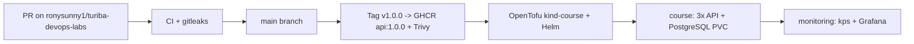
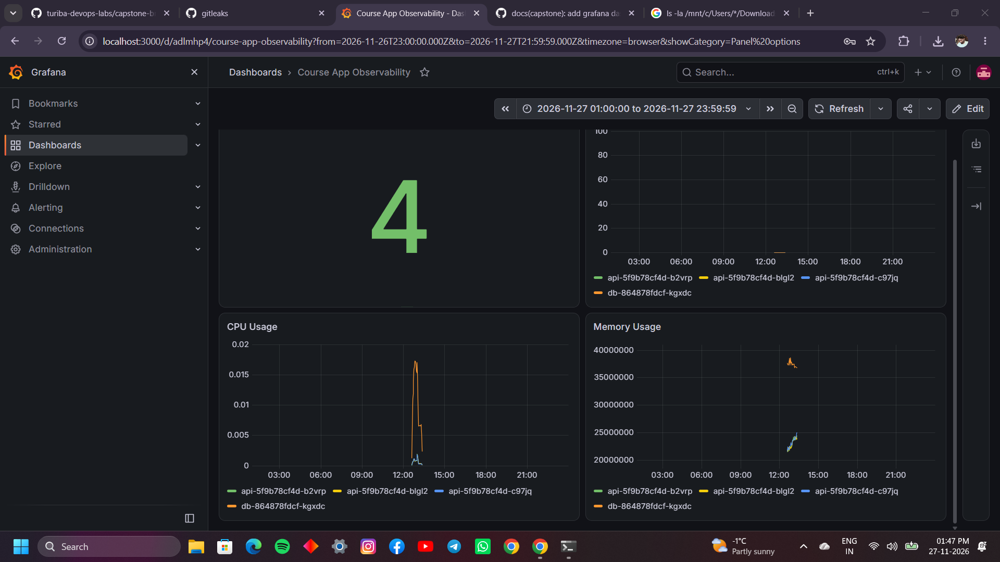

## Run it from zero

### 1. Local development with Docker Compose
```bash
git clone https://github.com/ronysunny1/turiba-devops-labs.git
cd turiba-devops-labs
cp .env.example .env
docker compose up -d
```

### 2. Kubernetes (kind), OpenTofu, and Helm
```bash
cd ~/turiba-devops-labs/infra
tofu init
tofu apply -auto-approve
kubectl get pods -n course
```

### 3. Observability (kube-prometheus-stack)
```bash
helm repo add prometheus-community https://prometheus-community.github.io/helm-charts
helm repo update
helm install kps prometheus-community/kube-prometheus-stack --namespace monitoring --create-namespace --wait
kubectl port-forward -n monitoring svc/kps-grafana 3000:80
```

---

## Architecture



Changes enter `ronysunny1/turiba-devops-labs` via pull requests into `main` under the `protect-main` ruleset requiring `lint`, `unit`, `integration`, `image`, and `gitleaks` checks, while Dependabot keeps dependencies updated. Tag `v1.0.0` runs `release.yml` with `aquasecurity/trivy-action` pinned to `v0.35.0` SHA `57a97c7e7821a5776cebc9bb87c984fa69cba8f1` and publishes multi-arch `api:1.0.0` to GHCR. OpenTofu in `infra/` provisions `kind-course`, creates `db-secret`, and deploys `charts/course-app`, while `kube-prometheus-stack` (`kps`) in `monitoring` scrapes pod metrics into Grafana.

---

## What is where

| Path | Role |
| :--- | :--- |
| `api/Dockerfile` | Multi-stage non-root Node.js API image |
| `compose.yaml` | Local Compose stack (`db`, `api`, `web`) |
| `.github/workflows/ci.yml` | CI (`lint`, `unit`, `integration`, `image` + smoke) |
| `.github/workflows/release.yml` | Multi-arch GHCR release workflow (`api:1.0.0`) |
| `.github/workflows/gitleaks.yml` | Secret scanning workflow |
| `.github/dependabot.yml` | Dependabot config (`/api` npm & docker, `/` github-actions) |
| `charts/course-app/` | Helm chart (API probes, resources, ConfigMap, Secret, DB PVC) |
| `infra/` | OpenTofu setup (`kind-course`, `course` namespace, `db-secret`, Helm) |
| `observability/dashboard.json` | Exported Grafana dashboard (`Course App Observability`) |
| `capstone/README.md` | Capstone documentation |

---

## Level and evidence

Target level claimed (with Minimum completed):
- **M1-M7:** Multi-stage non-root Dockerfile & Compose, protected `main` & PRs, CI with smoke test, tag `v1.0.0` & GHCR release, `charts/course-app` Helm chart, no secrets in Git, and `capstone/README.md`.
- **T1-T3:** OpenTofu `infra/`, required `gitleaks` check + SHA-pinned Trivy (`57a97c7e7821a5776cebc9bb87c984fa69cba8f1`) + Dependabot, and `kube-prometheus-stack` (`kps`) + `observability/dashboard.json`.



In `Course App Observability`, **Ready Pods** is `4` (`3` `api` pods + `1` `db` pod), **container Restarts** is `0` across all pods, **CPU Usage** peaks near `0.017` cores on `db` (`<0.002` cores on `api`), and **Memory Usage** sits around `38 MB` on `db` and `21-24 MB` on `api`.

---

## When it breaks

1. API pods failing readiness or crash-looping:
```bash
kubectl get pods,events -n course
kubectl logs -n course -l app=api --tail=100
```

2. PostgreSQL pod or PVC issues:
```bash
kubectl get pvc,pod -n course
kubectl describe pod -n course -l app=db
```

3. Docker / kind / Helm state:
```bash
docker ps && kind get clusters && helm status course-app -n course
```

---

## Extension

None claimed.

---

## Known issues


---

## AI use

Used AI assistance to troubleshoot WSL, Docker, OpenTofu, and Helm commands, formulate PromQL queries for Grafana, and structure `capstone/README.md`. All commands and outputs were run and verified locally in WSL.
